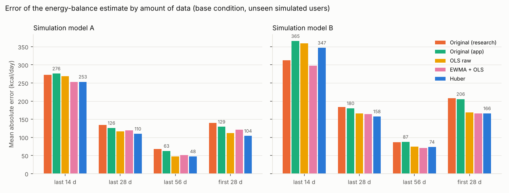
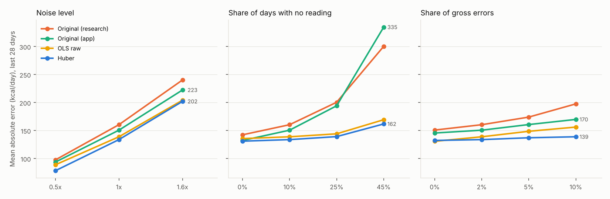
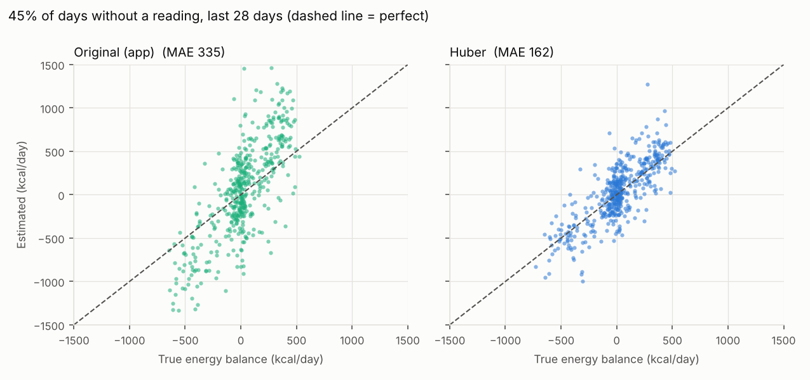
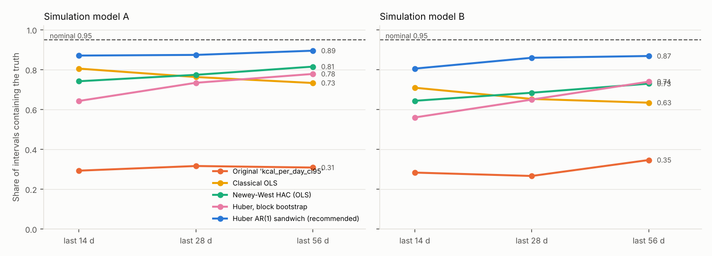
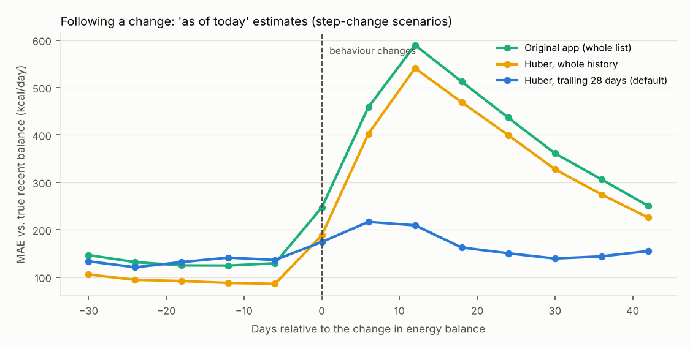
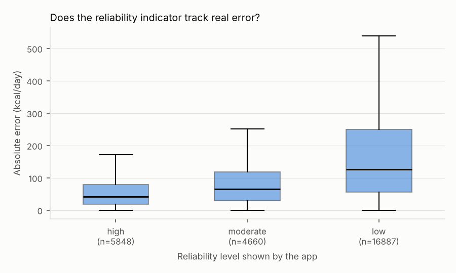

<!-- GENERATED by `python -m experiments.build_report` from docs/templates/EXPERIMENT_RESULTS.template.md. Edit the template, not this file. -->
# Experiment Results

**All results in this document come from computer-simulated weight logs.** They show how the methods behave under stated simulation assumptions. They are not real-world or clinical validation, and the kcal/day figures are approximate weight-trend-derived energy-balance equivalents, not measured physiological energy balance.

Every table and number below is generated from `results/experiments/` by `python -m experiments.build_report`; none is typed by hand. Reproduction commands are in section 15.

## 1. Summary of findings

1. **With missed days or gross errors, the corrected estimator is clearly more accurate than the original.** With 45% of days missing, mean absolute error over 28 days falls from 335 (original app) to 162 kcal/day. With 10% gross errors it falls from 170 to 139. In the base condition (10% missed days, 2% gross errors) it falls from 153 to 134 at 28 days and from 75 to 61 at 56 days.
2. **On complete, error-free logs the corrected estimator is not more accurate than the original.** Clean condition, 28 days: original app 127, corrected 130 kcal/day. The paired difference is +4.0 kcal/day (95% CI +1.7 to +6.2), i.e. the original is marginally better there.
3. **With only 14 days of data the original research module has lower average error** (292 vs 300 kcal/day). Section 6 shows this is because its smoothing shrinks every estimate towards zero by about a fifth at that length, which also makes it under-report sustained deficits. No method is useful at 14 days: all errors are around 300 kcal/day.
4. **The original "95% confidence interval" contained the truth 30% of the time.** The corrected interval contained it 86% of the time. That is a large improvement and still short of the nominal 95%; the software says so.
5. **The original app always printed a signed kcal number.** With 28 days of data, 15% of its deficit/surplus outputs pointed the wrong way. The corrected app names a deficit or surplus only when the interval supports it and at least 25 days are covered; with 28 days it does so for 44% of users and is wrong in direction for 4.1% of those.
6. **After a change in behaviour, the original headline number (fitted to the whole history) is far off**: 448 kcal/day error in the four weeks after a change, against 188 for the corrected trailing 28-day estimate. The original 5-entry bar chart had an error of 825 kcal/day throughout.
7. **The 7,700 kcal/kg conversion is itself a source of error that weight data cannot remove.** In the second simulation model the true factor differs by person; even a perfectly known tissue trend, converted at 7,700, differs from the true balance by a median of +7% (5th to 95th percentile -7% to +36%) (section 8).

## 2. Evaluation design

| Item | Choice |
|---|---|
| Data | Simulated 90-day daily weight logs with known daily energy balance (`SYNTHETIC_DATA_METHODOLOGY.md`) |
| Simulation models | A ("ledger", shares the 7700 assumption) and B ("two-compartment, adaptive", does not) |
| Scenarios | stable, sustained deficit, sustained surplus, deficit to maintenance, deficit to surplus, gradual drift |
| Observation conditions | base (10% missed days, 2% gross errors), clean (none), and sweeps of noise, missed days and gross errors |
| Development data | seed base 100000. Used for every design decision. The original pipeline is never run on it. |
| Evaluation data | seed base 900000, disjoint simulated users. Used once, for the numbers reported here. |
| Estimation windows | last 14, 28 and 56 days of the series, and the first 28 days |
| Target (ground truth) | mean true energy balance over the same calendar window, kcal/day |
| Evaluation size | 1800 simulated users in the base condition (150 per model-scenario cell), 1200 in the clean condition, 480 per sweep condition; 15819 window-level rows in total |
| Fairness | Every method receives exactly the same readings for each window. The original code runs unchanged from `src/legacy/` (byte-identical to the delivered ZIP, checked by a test) and is given a bare list of readings, as the original app was. A window with fewer than 7 readings is skipped for all methods alike. |
| Uncertainty of comparisons | Each row is an independent simulated user. Differences in absolute error are paired by user, with a bootstrap 95% CI (2000 resamples) and a Wilcoxon signed-rank test. |

Real-time ("as of day t") estimates use only readings up to day t. No method in the corrected pipeline smooths with future data.

## 3. Methods compared

| Method | What it does | Assumptions |
|---|---|---|
| Original: research module | EWMA (span 7), Isolation Forest (contamination 0.1) on residuals, flagged readings replaced by EWMA values, EWMA again, least squares against list position. `src/legacy/ml_engine_v1.py` | Readings are consecutive days; 10% of readings are anomalies; smoothing does not change the slope |
| Original: app | Same anomaly step, then least squares on the anomaly-replaced raw series against list position. `src/legacy/app_estimator_v1.py` | As above |
| Original steps, real day index | Research module with the regression run against actual days | Diagnostic: separates the missed-days defect from the smoothing/anomaly steps |
| EWMA then regression | EWMA then least squares on actual days, no anomaly step | Smoothing does not change the slope |
| Least squares on raw readings | Straight line through raw readings on actual days | Constant balance in the window; independent, outlier-free errors |
| Theil-Sen | Median of pairwise slopes | Constant balance; robust to roughly 29% contamination |
| **Huber regression (recommended)** | Straight line fitted by iteratively reweighted least squares; readings far from the line get reduced weight, none is deleted or replaced. `src/energy_balance.py` | Constant balance in the window; most readings are ordinary |

All methods convert kg/day to kcal/day by multiplying by 7700. Input unit kg, time unit days, output kcal/day; negative means deficit.

Interval methods compared: the original interval; classical least squares; Newey-West HAC; an AR(1) sandwich on actual day gaps with and without small-sample correction; moving-block bootstrap.

## 4. Decisions made on development data

**Point estimator.** Development mean absolute error (kcal/day):

| condition | mechanism | window | OLS raw | Huber | Theil-Sen | EWMA + OLS | n |
|---|---|---|---|---|---|---|---|
| base | A | first28 | 113 | 108 | 109 | 119 | 600 |
| base | A | last14 | 298 | 286 | 281 | 268 | 600 |
| base | A | last28 | 115 | 107 | 109 | 113 | 600 |
| base | A | last56 | 45 | 44 | 46 | 47 | 600 |
| base | B | first28 | 173 | 168 | 174 | 168 | 600 |
| base | B | last14 | 387 | 376 | 378 | 307 | 587 |
| base | B | last28 | 168 | 163 | 163 | 157 | 600 |
| base | B | last56 | 71 | 71 | 72 | 67 | 600 |
| clean | A | first28 | 104 | 105 | 106 | 109 | 600 |
| clean | A | last14 | 269 | 269 | 270 | 239 | 600 |
| clean | A | last28 | 105 | 105 | 106 | 97 | 600 |
| clean | A | last56 | 41 | 43 | 44 | 42 | 600 |
| clean | B | first28 | 163 | 163 | 164 | 161 | 600 |
| clean | B | last14 | 347 | 349 | 349 | 294 | 600 |
| clean | B | last28 | 155 | 156 | 157 | 146 | 600 |
| clean | B | last56 | 68 | 69 | 68 | 63 | 600 |

| condition | OLS raw | Huber | Theil-Sen | EWMA + OLS | n |
|---|---|---|---|---|---|
| base | 141 | 135 | 136 | 135 | 1200 |
| clean | 130 | 130 | 131 | 122 | 1200 |
| missing_0 | 134 | 130 | 130 | 126 | 360 |
| missing_25 | 148 | 145 | 147 | 139 | 360 |
| missing_45 | 159 | 153 | 169 | 141 | 354 |
| noise_high | 207 | 206 | 207 | 189 | 360 |
| noise_low | 88 | 79 | 79 | 83 | 360 |
| outliers_0 | 133 | 133 | 134 | 121 | 360 |
| outliers_10 | 165 | 141 | 142 | 155 | 360 |
| outliers_5 | 146 | 136 | 137 | 138 | 360 |

Huber regression was chosen: it matches plain least squares on clean data and is the most accurate under gross errors. EWMA-then-regression had lower error at 14 days on development data too; it was not chosen because that advantage is shrinkage (section 6).

**Interval method.** Share of development intervals containing the tissue-trend equivalent (nominal 0.95):

| interval | A first 28 d | A last 14 d | A last 28 d | A last 56 d | B first 28 d | B last 14 d | B last 28 d | B last 56 d |
|---|---|---|---|---|---|---|---|---|
| Classical OLS | 0.74 | 0.77 | 0.72 | 0.74 | 0.63 | 0.65 | 0.61 | 0.59 |
| Newey-West HAC (OLS) | 0.77 | 0.71 | 0.76 | 0.86 | 0.69 | 0.63 | 0.68 | 0.73 |
| AR(1) sandwich (OLS) | 0.90 | 0.86 | 0.89 | 0.92 | 0.85 | 0.82 | 0.86 | 0.89 |
| Huber, independence | 0.73 | 0.76 | 0.71 | 0.73 | 0.60 | 0.63 | 0.58 | 0.57 |
| Huber AR(1), no small-sample correction | 0.87 | 0.83 | 0.85 | 0.91 | 0.81 | 0.75 | 0.81 | 0.86 |
| Huber AR(1) sandwich (recommended) | 0.90 | 0.86 | 0.88 | 0.92 | 0.85 | 0.80 | 0.86 | 0.89 |
| Huber, block bootstrap | 0.75 | 0.64 | 0.73 | 0.83 | 0.66 | 0.53 | 0.63 | 0.74 |

The AR(1) sandwich with small-sample correction was chosen as the best-calibrated option (pooled 87% against 68% for the classical formula). None reached 95%.

**Default window for the current estimate.** Development error against the true balance of the last 14 days:

| phase | trailing 14 | trailing 21 | trailing 28 | trailing 42 | full history |
|---|---|---|---|---|---|
| 0-27 days after change | 330 | 205 | 194 | 275 | 411 |
| 28+ days after change | 312 | 193 | 127 | 107 | 316 |
| before the change | 309 | 191 | 136 | 102 | 101 |
| no change in scenario | 316 | 191 | 132 | 92 | 93 |
| worst phase | 330 | 205 | 194 | 275 | 411 |

28 days was chosen because it has the smallest worst-phase error. A 42-day window is better when behaviour is steady and worse just after a change.

**Minimum history for naming a deficit or surplus.** Development results, base condition, before any minimum-history rule:

| days of data | n users | no estimate shown | definite label given | definite labels equal to the true class | definite labels pointing the WRONG WAY |
|---|---|---|---|---|---|
| 14 | 1200 | 0.247 | 0.195 | 0.688 | 0.150 |
| 21 | 1200 | 0.003 | 0.350 | 0.736 | 0.093 |
| 28 | 1200 | 0.000 | 0.458 | 0.809 | 0.045 |
| 42 | 1200 | 0.000 | 0.646 | 0.892 | 0.014 |
| 56 | 1200 | 0.000 | 0.778 | 0.895 | 0.010 |

Direction calls on 14 or 21 days of data were wrong 9-15% of the time. Grouped by actual days covered, the wrong-direction rate first dropped to 5% or less at 25-27 days, so the application gives no label below 25 days.

**Forecast method (secondary).** See section 11.

## 5. Results on evaluation data

### 5.1 Base condition: mean absolute error, kcal/day

| method | A last 14 d | A last 28 d | A last 56 d | A first 28 d | B last 14 d | B last 28 d | B last 56 d | B first 28 d |
|---|---|---|---|---|---|---|---|---|
| Original: research module (EWMA + IF + EWMA) | 272 | 134 | 68 | 140 | 312 | 184 | 86 | 208 |
| Original: app (IF-replaced raw) | 276 | 126 | 63 | 129 | 365 | 180 | 87 | 206 |
| Original steps, real day index | 251 | 122 | 54 | 129 | 282 | 162 | 70 | 166 |
| EWMA then regression (no IF) | 253 | 119 | 51 | 121 | 297 | 164 | 71 | 166 |
| Least squares on raw readings | 269 | 116 | 48 | 112 | 359 | 166 | 75 | 169 |
| Theil-Sen | 261 | 110 | 49 | 105 | 349 | 162 | 75 | 169 |
| Huber regression (recommended) | 253 | 110 | 48 | 104 | 347 | 158 | 74 | 166 |

Bias (mean of estimate minus truth):

| method | A last 14 d | A last 28 d | A last 56 d | A first 28 d | B last 14 d | B last 28 d | B last 56 d | B first 28 d |
|---|---|---|---|---|---|---|---|---|
| Original: research module (EWMA + IF + EWMA) | -15 | -9 | -24 | +2 | -35 | +15 | +9 | -67 |
| Original: app (IF-replaced raw) | -1 | +3 | -8 | -20 | -13 | +18 | +19 | -73 |
| Original steps, real day index | -18 | -8 | -14 | +28 | -37 | +7 | +10 | -32 |
| EWMA then regression (no IF) | -15 | -5 | -10 | +21 | -31 | +9 | +12 | -32 |
| Least squares on raw readings | +4 | +8 | +6 | +1 | -8 | +12 | +22 | -38 |
| Theil-Sen | +3 | +7 | +6 | +0 | -13 | +7 | +22 | -38 |
| Huber regression (recommended) | +1 | +8 | +7 | +0 | -7 | +11 | +23 | -38 |

RMSE:

| method | A last 14 d | A last 28 d | A last 56 d | A first 28 d | B last 14 d | B last 28 d | B last 56 d | B first 28 d |
|---|---|---|---|---|---|---|---|---|
| Original: research module (EWMA + IF + EWMA) | 371 | 182 | 90 | 189 | 438 | 247 | 116 | 277 |
| Original: app (IF-replaced raw) | 362 | 163 | 80 | 168 | 503 | 234 | 118 | 276 |
| Original steps, real day index | 336 | 164 | 72 | 173 | 389 | 217 | 94 | 219 |
| EWMA then regression (no IF) | 338 | 156 | 66 | 159 | 402 | 215 | 94 | 217 |
| Least squares on raw readings | 355 | 148 | 62 | 145 | 468 | 216 | 99 | 222 |
| Theil-Sen | 341 | 142 | 64 | 137 | 460 | 216 | 100 | 223 |
| Huber regression (recommended) | 333 | 141 | 62 | 136 | 454 | 210 | 98 | 221 |



### 5.2 Clean condition (no missed days, no gross errors)

| method | A last 14 d | A last 28 d | A last 56 d | A first 28 d | B last 14 d | B last 28 d | B last 56 d | B first 28 d |
|---|---|---|---|---|---|---|---|---|
| Original: research module (EWMA + IF + EWMA) | 239 | 111 | 50 | 116 | 272 | 152 | 67 | 169 |
| Original: app (IF-replaced raw) | 236 | 103 | 45 | 102 | 304 | 150 | 69 | 160 |
| Original steps, real day index | 239 | 111 | 50 | 116 | 272 | 152 | 67 | 169 |
| EWMA then regression (no IF) | 233 | 104 | 47 | 107 | 278 | 153 | 68 | 167 |
| Least squares on raw readings | 242 | 105 | 45 | 99 | 331 | 155 | 72 | 162 |
| Theil-Sen | 252 | 105 | 48 | 100 | 332 | 157 | 73 | 167 |
| Huber regression (recommended) | 245 | 107 | 47 | 100 | 331 | 154 | 73 | 164 |

In this condition "Original steps, real day index" equals the original research module because list position and day index coincide. Differences between methods are within about 10 kcal/day except at 14 days.

### 5.3 By scenario (base condition, last 28 days)

| mechanism | scenario | Original (research) | Original (app) | OLS raw | Huber | Huber bias | n |
|---|---|---|---|---|---|---|---|
| A | deficit_to_maintenance | 136 | 129 | 123 | 110 | 33 | 150 |
| A | deficit_to_surplus | 139 | 124 | 107 | 101 | 22 | 150 |
| A | gradual_drift | 111 | 115 | 109 | 109 | -23 | 150 |
| A | stable | 148 | 136 | 127 | 117 | -6 | 150 |
| A | sustained_deficit | 127 | 119 | 110 | 107 | 13 | 150 |
| A | sustained_surplus | 143 | 133 | 121 | 114 | 6 | 150 |
| B | deficit_to_maintenance | 184 | 176 | 161 | 154 | 11 | 150 |
| B | deficit_to_surplus | 214 | 216 | 192 | 180 | 73 | 150 |
| B | gradual_drift | 186 | 161 | 145 | 134 | 38 | 150 |
| B | stable | 167 | 174 | 164 | 160 | -31 | 150 |
| B | sustained_deficit | 164 | 172 | 172 | 161 | -23 | 150 |
| B | sustained_surplus | 188 | 182 | 163 | 156 | -5 | 150 |

### 5.4 Stress sweeps (last 28 days; the same 480 simulated users in every row of a table)

Noise level:

| condition | Original (research) | Original (app) | Original + real days | EWMA + OLS | OLS raw | Theil-Sen | Huber | bias original (app) | bias Huber | n |
|---|---|---|---|---|---|---|---|---|---|---|
| noise_low | 98 | 94 | 88 | 90 | 89 | 78 | 78 | 13 | 16 | 480 |
| base | 161 | 151 | 145 | 144 | 139 | 137 | 134 | 14 | 18 | 480 |
| noise_high | 240 | 223 | 217 | 212 | 204 | 208 | 202 | 14 | 19 | 480 |

Missed days:

| condition | Original (research) | Original (app) | Original + real days | EWMA + OLS | OLS raw | Theil-Sen | Huber | bias original (app) | bias Huber | n |
|---|---|---|---|---|---|---|---|---|---|---|
| missing_0 | 143 | 132 | 143 | 142 | 136 | 133 | 131 | 7 | 13 | 480 |
| base | 161 | 151 | 145 | 144 | 139 | 137 | 134 | 14 | 18 | 480 |
| missing_25 | 201 | 194 | 149 | 147 | 144 | 142 | 139 | 18 | 16 | 480 |
| missing_45 | 300 | 335 | 157 | 159 | 169 | 162 | 162 | 23 | 13 | 474 |

Gross errors:

| condition | Original (research) | Original (app) | Original + real days | EWMA + OLS | OLS raw | Theil-Sen | Huber | bias original (app) | bias Huber | n |
|---|---|---|---|---|---|---|---|---|---|---|
| outliers_0 | 151 | 146 | 136 | 132 | 131 | 134 | 132 | 14 | 16 | 480 |
| base | 161 | 151 | 145 | 144 | 139 | 137 | 134 | 14 | 18 | 480 |
| outliers_5 | 174 | 161 | 157 | 158 | 149 | 140 | 137 | 14 | 19 | 480 |
| outliers_10 | 198 | 170 | 179 | 174 | 156 | 140 | 139 | -1 | 15 | 480 |



The original methods degrade steeply with missed days because skipped days are treated as consecutive, which inflates the slope. Once the real day index is used ("Original steps, real day index") that degradation disappears. The original anomaly step does not protect against gross errors: its error grows from 0% to 10% contamination, where Huber's is almost flat.



### 5.5 Paired comparisons with uncertainty

Negative values mean the Huber estimate is closer to the truth.

| data | Huber compared with | n users | mean change in abs. error (kcal/day) | Wilcoxon p | share of users where Huber is closer |
|---|---|---|---|---|---|
| base, last 28 d | Original (research) | 1800 | -25.3 (-31.9 to -19.2) | <0.001 | 57% |
| base, last 28 d | Original (app) | 1800 | -19.3 (-22.8 to -15.9) | <0.001 | 60% |
| base, last 28 d | EWMA + OLS | 1800 | -8.1 (-12.6 to -3.4) | 0.004 | 53% |
| base, last 28 d | OLS raw | 1800 | -7.5 (-9.5 to -5.5) | <0.001 | 54% |
| base, last 56 d | Original (research) | 1800 | -16.8 (-19.4 to -14.1) | <0.001 | 61% |
| base, last 56 d | Original (app) | 1800 | -14.5 (-16.2 to -12.8) | <0.001 | 63% |
| base, last 56 d | EWMA + OLS | 1800 | -0.3 (-2.0 to +1.4) | 0.731 | 51% |
| base, last 56 d | OLS raw | 1800 | -0.8 (-1.6 to -0.1) | 0.043 | 51% |
| base, last 14 d | Original (research) | 1785 | +7.7 (-4.7 to +20.1) | 0.004 | 47% |
| base, last 14 d | Original (app) | 1785 | -20.5 (-29.2 to -12.4) | 0.005 | 52% |
| base, last 14 d | EWMA + OLS | 1785 | +24.8 (+13.9 to +35.4) | <0.001 | 45% |
| base, last 14 d | OLS raw | 1785 | -13.9 (-18.6 to -9.2) | <0.001 | 48% |
| clean, last 28 d | Original (research) | 1200 | -1.0 (-6.4 to +4.6) | 0.537 | 51% |
| clean, last 28 d | Original (app) | 1200 | +4.0 (+1.7 to +6.2) | 0.013 | 48% |
| clean, last 28 d | EWMA + OLS | 1200 | +2.0 (-2.5 to +6.6) | 0.502 | 50% |
| clean, last 28 d | OLS raw | 1200 | +0.8 (-0.5 to +2.1) | 0.313 | 48% |
| clean, last 56 d | Original (research) | 1200 | +1.1 (-1.1 to +3.2) | 0.561 | 49% |
| clean, last 56 d | Original (app) | 1200 | +2.7 (+1.7 to +3.6) | <0.001 | 46% |
| clean, last 56 d | EWMA + OLS | 1200 | +2.1 (+0.3 to +3.8) | 0.144 | 50% |
| clean, last 56 d | OLS raw | 1200 | +0.9 (+0.4 to +1.4) | 0.008 | 48% |
| missing 45%, last 28 d | Original (research) | 474 | -138.5 (-159.4 to -116.4) | <0.001 | 73% |
| missing 45%, last 28 d | Original (app) | 474 | -172.8 (-194.2 to -152.5) | <0.001 | 82% |
| missing 45%, last 28 d | EWMA + OLS | 474 | +3.0 (-7.7 to +13.9) | 0.308 | 47% |
| missing 45%, last 28 d | OLS raw | 474 | -7.6 (-13.1 to -2.1) | 0.038 | 47% |
| gross errors 10%, last 28 d | Original (research) | 480 | -58.7 (-72.9 to -45.3) | <0.001 | 61% |
| gross errors 10%, last 28 d | Original (app) | 480 | -31.0 (-39.4 to -23.6) | <0.001 | 64% |
| gross errors 10%, last 28 d | EWMA + OLS | 480 | -35.0 (-46.7 to -23.9) | <0.001 | 56% |
| gross errors 10%, last 28 d | OLS raw | 480 | -17.3 (-23.0 to -11.5) | <0.001 | 57% |
| high noise, last 28 d | Original (research) | 480 | -38.2 (-53.7 to -22.0) | <0.001 | 59% |
| high noise, last 28 d | Original (app) | 480 | -20.3 (-29.1 to -12.2) | <0.001 | 60% |
| high noise, last 28 d | EWMA + OLS | 480 | -10.0 (-22.2 to +2.5) | 0.117 | 54% |
| high noise, last 28 d | OLS raw | 480 | -2.1 (-6.8 to +2.7) | 0.481 | 50% |

Reading this table: improvements over both original variants are statistically clear in the base, missed-days, gross-error and high-noise conditions. In the clean condition they are absent or slightly reversed. Against plain least squares on raw readings, Huber's advantage is small unless gross errors are common.

### 5.6 Deficit / surplus / maintenance classification

Truth class uses a tolerance of ±100 kcal/day. Accuracy when every method is forced to give one of three labels from its point estimate:

| data | n | Original (research) | Original (app) | Original + real days | EWMA + OLS | OLS raw | Theil-Sen | Huber |
|---|---|---|---|---|---|---|---|---|
| base, last 28 d | 1800 | 0.647 | 0.658 | 0.657 | 0.656 | 0.662 | 0.687 | 0.687 |
| base, last 56 d | 1800 | 0.841 | 0.844 | 0.858 | 0.862 | 0.857 | 0.846 | 0.857 |
| base, last 14 d | 1785 | 0.495 | 0.502 | 0.500 | 0.498 | 0.511 | 0.518 | 0.525 |

Three-way accuracy is modest for every method at 14 and 28 days, because the tolerance band (±100) is narrower than the estimation error. This is why the application does not force a label. What the application actually shows:

| days of data | n users | no estimate shown | definite label given | definite labels equal to the true class | definite labels pointing the WRONG WAY |
|---|---|---|---|---|---|
| 14 | 1200 | 0.233 | 0.000 |  |  |
| 21 | 1200 | 0.003 | 0.000 |  |  |
| 28 | 1200 | 0.000 | 0.445 | 0.815 | 0.041 |
| 42 | 1200 | 0.000 | 0.656 | 0.902 | 0.015 |
| 56 | 1200 | 0.000 | 0.779 | 0.891 | 0.009 |

For comparison, the original app's printed number, read as a label:

| days of data | n users | original app: share of deficit/surplus outputs | of which pointing the WRONG WAY |
|---|---|---|---|
| last 14 d | 1785 | 0.829 | 0.245 |
| last 28 d | 1800 | 0.752 | 0.149 |
| last 56 d | 1800 | 0.692 | 0.020 |

## 6. Why the original smoothing looks better at 14 days

EWMA with a fixed start value, followed by regression, multiplies the slope of a noise-free line by a factor k below one (about 0.81 at 14 days, 0.93 at 28, 0.98 at 56). Shrinking every estimate towards zero lowers average error when true values are scattered around zero, as they are in these scenarios. Two controls test whether that is the whole explanation: multiply the Huber estimate by the same k, and divide the EWMA estimate by k.

| data | mean shrink factor k | MAE Huber | MAE Huber x k | MAE EWMA + OLS | MAE (EWMA + OLS) / k | MAE Original (research) | size ratio Huber | size ratio EWMA + OLS | size ratio Original (research) |
|---|---|---|---|---|---|---|---|---|---|
| base, last 14 d | 0.77 | 299.64 | 233.48 | 274.79 | 355.33 | 291.95 | 1.04 | 0.81 | 0.83 |
| base, last 28 d | 0.91 | 133.65 | 122.53 | 141.72 | 154.82 | 158.96 | 1.00 | 0.92 | 0.99 |
| base, last 56 d | 0.97 | 60.52 | 58.69 | 60.80 | 63.27 | 77.28 | 1.03 | 1.01 | 1.11 |
| clean, last 14 d | 0.81 | 288.24 | 232.92 | 255.60 | 315.91 | 255.34 | 1.05 | 0.84 | 0.78 |
| clean, last 28 d | 0.93 | 130.49 | 120.99 | 128.53 | 138.60 | 131.49 | 1.01 | 0.95 | 0.92 |
| clean, last 56 d | 0.98 | 59.67 | 57.98 | 57.56 | 59.55 | 58.58 | 1.04 | 1.02 | 1.01 |

"Size ratio" is the regression of the estimate on the truth over the sustained-deficit and sustained-surplus scenarios; 1.00 means sizes are reported correctly on average.

At 14 days the explicitly shrunk Huber estimate has lower error than the EWMA method, and the un-shrunk EWMA estimate has higher error than Huber. So the smoothing adds no information; it applies an undeclared, window-length-dependent shrinkage. The cost is that sustained deficits and surpluses are under-reported: size ratio 0.83 for the original research module at 14 days against 1.04 for Huber. The recommended estimator reports the unshrunk slope and states its uncertainty instead. A deliberate, documented shrinkage could be added later, but its benefit depends on how real users' balances are distributed, which this project cannot know.

## 7. Confidence intervals

Share of evaluation intervals (base condition) containing the tissue-trend equivalent; nominal 0.95:

| interval | A last 14 d | A last 28 d | A last 56 d | A first 28 d | B last 14 d | B last 28 d | B last 56 d | B first 28 d |
|---|---|---|---|---|---|---|---|---|
| Original 'kcal_per_day_ci95' | 0.29 | 0.32 | 0.31 | 0.28 | 0.28 | 0.27 | 0.35 | 0.27 |
| Classical OLS | 0.80 | 0.76 | 0.73 | 0.79 | 0.71 | 0.65 | 0.63 | 0.66 |
| Newey-West HAC (OLS) | 0.74 | 0.77 | 0.81 | 0.79 | 0.64 | 0.68 | 0.73 | 0.72 |
| AR(1) sandwich (OLS) | 0.88 | 0.89 | 0.91 | 0.90 | 0.84 | 0.84 | 0.86 | 0.86 |
| Huber, independence | 0.79 | 0.73 | 0.67 | 0.74 | 0.66 | 0.63 | 0.57 | 0.63 |
| Huber AR(1), no small-sample correction | 0.85 | 0.85 | 0.88 | 0.86 | 0.75 | 0.81 | 0.85 | 0.81 |
| Huber AR(1) sandwich (recommended) | 0.87 | 0.87 | 0.89 | 0.89 | 0.80 | 0.86 | 0.87 | 0.86 |
| Huber, block bootstrap | 0.64 | 0.73 | 0.78 | 0.75 | 0.56 | 0.65 | 0.74 | 0.64 |

Containing the true energy balance:

| interval | A last 14 d | A last 28 d | A last 56 d | A first 28 d | B last 14 d | B last 28 d | B last 56 d | B first 28 d |
|---|---|---|---|---|---|---|---|---|
| Original 'kcal_per_day_ci95' | 0.29 | 0.32 | 0.31 | 0.28 | 0.27 | 0.26 | 0.31 | 0.25 |
| Classical OLS | 0.80 | 0.76 | 0.73 | 0.79 | 0.71 | 0.63 | 0.59 | 0.62 |
| Newey-West HAC (OLS) | 0.74 | 0.77 | 0.81 | 0.79 | 0.65 | 0.67 | 0.69 | 0.67 |
| AR(1) sandwich (OLS) | 0.88 | 0.89 | 0.91 | 0.90 | 0.84 | 0.83 | 0.83 | 0.82 |
| Huber, independence | 0.79 | 0.73 | 0.67 | 0.74 | 0.66 | 0.60 | 0.54 | 0.58 |
| Huber AR(1), no small-sample correction | 0.85 | 0.85 | 0.88 | 0.86 | 0.75 | 0.79 | 0.81 | 0.78 |
| Huber AR(1) sandwich (recommended) | 0.87 | 0.87 | 0.89 | 0.89 | 0.80 | 0.85 | 0.83 | 0.84 |
| Huber, block bootstrap | 0.64 | 0.73 | 0.78 | 0.75 | 0.56 | 0.63 | 0.68 | 0.62 |

Mean interval width, kcal/day:

| interval | A last 14 d | A last 28 d | A last 56 d | A first 28 d | B last 14 d | B last 28 d | B last 56 d | B first 28 d |
|---|---|---|---|---|---|---|---|---|
| Original 'kcal_per_day_ci95' | 248 | 130 | 70 | 134 | 267 | 160 | 84 | 161 |
| Classical OLS | 987 | 357 | 137 | 364 | 1029 | 386 | 151 | 389 |
| Newey-West HAC (OLS) | 857 | 370 | 173 | 374 | 920 | 435 | 195 | 448 |
| AR(1) sandwich (OLS) | 1576 | 619 | 247 | 617 | 1733 | 814 | 358 | 853 |
| Huber, independence | 864 | 310 | 124 | 312 | 882 | 333 | 132 | 343 |
| Huber AR(1), no small-sample correction | 1254 | 501 | 226 | 491 | 1392 | 683 | 327 | 726 |
| Huber AR(1) sandwich (recommended) | 1512 | 613 | 267 | 612 | 1726 | 867 | 412 | 914 |
| Huber, block bootstrap | 651 | 322 | 157 | 325 | 687 | 372 | 193 | 377 |



Interpretation:

- The original interval is computed from residuals of an already-smoothed series. It is about 156 kcal/day wide on average and contains the truth 30% of the time. It should not have been called a 95% interval.
- Classical least-squares intervals ignore day-to-day persistence of water weight and cover about 72%.
- Newey-West HAC and the block bootstrap, the usual autocorrelation-aware choices, are no better here (74% and 69%). Both are known to be unreliable with only 14-56 observations.
- The AR(1) sandwich covers 86% overall. It still under-covers because (a) the autocorrelation is estimated from very few points, (b) real noise is not exactly AR(1), and (c) the balance is not constant inside the window, which the straight-line model assumes.

To reach 95% coverage the recommended interval would have needed to be wider by these factors:

| window | A | B |
|---|---|---|
| last 14 d | 1.48 | 1.86 |
| last 28 d | 1.39 | 1.61 |
| last 56 d | 1.23 | 1.55 |
| first 28 d | 1.47 | 1.66 |

No such factor is applied in the software. It would be calibrated to this simulator, not to real people. The application instead labels the interval "approximate" and states this shortfall.

Three different uncertainties are kept apart in code and interface: the trend-slope interval (kg/day), the energy-equivalent interval (the same interval multiplied by 7700; it excludes uncertainty in 7700), and the prediction interval for a future scale reading (section 10).

## 8. The conversion factor (simulation model B)

In model B a kilogram of tissue change is not worth 7700 kcal. For sustained scenarios, clean condition, last 56 days (n = 200), the ratio of the tissue-trend equivalent to the true balance has median 1.07 (5th-95th percentile 0.93 to 1.36). Huber's error against the true balance is 62 kcal/day, of which 48 is error in the trend itself.

| mechanism | window | Huber MAE vs true balance | Huber MAE vs tissue-trend equivalent | bias vs true balance |
|---|---|---|---|---|
| A | first28 | +104 | +104 | +0 |
| A | last14 | +253 | +253 | +1 |
| A | last28 | +110 | +110 | +8 |
| A | last56 | +48 | +48 | +7 |
| B | first28 | +166 | +156 | -38 |
| B | last14 | +347 | +346 | -7 |
| B | last28 | +158 | +153 | +11 |
| B | last56 | +74 | +67 | +23 |

No analysis of weight alone can remove this part of the error. It is the reason the output is described as an energy-balance *equivalent*.

## 9. Estimates over time ("as of today")

Error against the true mean balance of the most recent 14 days, using only readings available on each day:

| method | 0-27 days after change | 28+ days after change | before the change | no change in scenario | all days |
|---|---|---|---|---|---|
| Original app headline (whole list) | 448 | 320 | 136 | 122 | 177 |
| Original app 5-entry bar chart | 834 | 773 | 817 | 829 | 825 |
| Huber, whole history | 397 | 289 | 96 | 97 | 145 |
| Huber, trailing 14 d | 320 | 297 | 304 | 321 | 317 |
| Huber, trailing 28 d (default) | 188 | 146 | 133 | 137 | 144 |
| Huber, trailing 42 d | 265 | 105 | 98 | 95 | 118 |



The original app's headline number was a fit to the entire history, so it describes the average since day one. Its 5-entry bar chart divided the difference of two single readings by five; its error is larger than any plausible true value. The corrected default (trailing 28 days) is not the best in every phase: a 42-day window has lower error when nothing changes. The window is user-selectable.

## 10. Reliability indicator

The application shows a level (high / moderate / low / insufficient) derived from interval width and data-quality checks. Realised error on evaluation data by displayed level (five conditions, windows of 14-56 days, n = 30000 user-windows):

| reliability | n | MAE (kcal/day) | median abs. error | 90th percentile abs. error | share within 150 kcal/day | interval coverage |
|---|---|---|---|---|---|---|
| high | 5848 | 57.19 | 41.63 | 125.56 | 0.94 | 0.82 |
| moderate | 4660 | 86.79 | 65.07 | 190.73 | 0.84 | 0.87 |
| low | 16887 | 191.40 | 125.88 | 439.86 | 0.57 | 0.90 |



The ordering is as intended: median error 42, 65 and 126 kcal/day for high, moderate and low. Note the last column: intervals in the "high" group cover least often (82%), because a narrow interval is partly a sign that persistence was underestimated. The level describes data quality; it is not a probability of being right, and the interface says so.

How often each level appears, base condition:

| days of data in the window | no estimate (insufficient data) | high | moderate | low |
|---|---|---|---|---|
| 14 days | 0.23 | 0.00 | 0.00 | 0.77 |
| 21 days | 0.00 | 0.00 | 0.00 | 1.00 |
| 28 days | 0.00 | 0.15 | 0.36 | 0.49 |
| 42 days | 0.00 | 0.45 | 0.30 | 0.24 |
| 56 days | 0.00 | 0.65 | 0.16 | 0.20 |

By condition (all window lengths):

| condition | no estimate | high | moderate | low |
|---|---|---|---|---|
| base | 0.05 | 0.25 | 0.16 | 0.54 |
| missing_45 | 0.25 | 0.02 | 0.19 | 0.54 |
| noise_high | 0.05 | 0.11 | 0.14 | 0.70 |
| noise_low | 0.05 | 0.37 | 0.12 | 0.46 |
| outliers_10 | 0.05 | 0.23 | 0.16 | 0.57 |

## 11. Forecasting (secondary feature)

Seven-day-ahead error on scale readings, scenario simulator, base condition. Development data (used to choose the default):

| method | MAE (kg), all forecasts | MAE (kg), model A | MAE (kg), model B | MAE (kg), subset with 14 complete days |
|---|---|---|---|---|
| Recent level: mean of last 3 readings (app default) | 0.501 | 0.503 | 0.500 | 0.490 |
| Persistence (last reading) | 0.522 | 0.523 | 0.521 | 0.516 |
| Linear trend, last 14 days | 0.595 | 0.572 | 0.619 | 0.604 |
| Original fallback (2-point) | 0.693 | 0.685 | 0.703 | 0.691 |
| Optional LSTM, window-centred (needs 14 complete days) |  |  |  | 0.491 |

Evaluation data:

| method | MAE (kg), all forecasts | MAE (kg), model A | MAE (kg), model B | MAE (kg), subset with 14 complete days |
|---|---|---|---|---|
| Recent level: mean of last 3 readings (app default) | 0.490 | 0.480 | 0.501 | 0.476 |
| Persistence (last reading) | 0.518 | 0.521 | 0.514 | 0.498 |
| Linear trend, last 14 days | 0.579 | 0.527 | 0.634 | 0.573 |
| Original fallback (2-point) | 0.692 | 0.696 | 0.689 | 0.652 |
| Optional LSTM, window-centred (needs 14 complete days) |  |  |  | 0.477 |

80% prediction intervals on evaluation data:

| prediction band | coverage (nominal 0.80) | mean width (kg) | n |
|---|---|---|---|
| Recent level, personal-backtest band (app default) | 0.829 | 1.721 | 13282 |
| Linear trend, classical regression band | 0.661 | 1.436 | 13282 |

| horizon | level-band coverage | linear-band coverage |
|---|---|---|
| 1 | 0.839 | 0.757 |
| 2 | 0.838 | 0.698 |
| 3 | 0.835 | 0.673 |
| 4 | 0.824 | 0.647 |
| 5 | 0.828 | 0.623 |
| 6 | 0.823 | 0.613 |
| 7 | 0.818 | 0.617 |

On the internship cohort (independent noise, `results/forecast_reevaluation.json`) the same methods score: corrected LSTM 0.371, recent level 0.395, linear trend 0.401, persistence 0.468 kg.

Findings:

- The saved internship figures (LSTM 0.537, persistence 0.468, linear 0.401 kg) are reproduced exactly from the saved model and regenerated cohort. They are historical values from `results/model_evaluation.json`.
- The saved LSTM was evaluated with one normalisation and deployed with another. Scored the way the app called it, the same model gives 0.420 kg (14-day log) or 0.485 kg (full history), not 0.537. The published number did not describe the deployed model.
- The original fallback used when TensorFlow was missing is the least accurate method in every comparison (0.692 kg here).
- With consistent normalisation the retrained LSTM is the best method on the internship cohort and ties the recent-level rule on the scenario simulator (0.477 vs 0.476 kg on the subset where it can run).
- The linear trend, best of the original baselines on the internship cohort, is worse than repeating the last reading on the scenario simulator. Rankings depend on the noise model; all differences are small next to single-reading scatter.
- The application default is the recent-level rule: it needs no TensorFlow, tolerates missed days, and its prediction band covered 83% against a nominal 80%. Its known weakness: it ignores the trend, so in the sustained-deficit scenario its forecasts are on average 0.31 kg too high.

## 12. Failure cases

| Situation | Evidence | What the software does |
|---|---|---|
| Two weeks of data | Error about 250-350 kcal/day for every method; direction calls wrong 13-15% of the time | No label below 25 days; reliability held at "low"; no number at all below 10 readings / 14 days |
| Balance changes inside the window | Trailing 28-day estimate: error 188 kcal/day in the 4 weeks after a change against 137 when nothing changes | Window is selectable; whole-period and recent figures shown side by side; stated in limitations |
| Start of a diet (model B, first 28 days) | Negative bias (see the bias table in 5.1): early water loss reads as extra deficit | Stated in limitations |
| Conversion factor wrong for the person | Section 8 | Output named "equivalent"; assumption stated next to the result |
| 45% of days missed | Error at 28 days rises from 134 to 162 kcal/day; about a quarter of user-windows get no estimate | Missed-days check lowers reliability |
| Complete, clean logs | No accuracy gain over the original | Reported here |
| Interval calibration | 86% instead of 95% | Labelled approximate; shortfall stated in the app |

## 13. Limitations

1. Simulation only. No real weight log was analysed.
2. Both simulation models were written by the author of the estimator. Using two models reduces, and does not remove, the risk of circularity. Model B's constants were not re-verified against their literature sources.
3. The original pipeline's results depend on the fixed `random_state=42` of its Isolation Forest, as shipped.
4. Thresholds (±100 kcal/day tolerance, reliability cut-offs at 150 and 300 kcal/day, 25-day minimum) were set on development simulations and may not transfer to real users.
5. Average-error comparisons favour shrinkage because simulated balances are centred near zero (section 6).
6. Only one conversion factor (7700) was evaluated.
7. Paired tests treat simulated users as independent, which they are by construction; the same user appears in several conditions, so different rows of the paired table are not independent of each other.

## 14. Evidence for the recommended method

Huber regression on raw readings against real days, with an AR(1)-sandwich interval, a 28-day default window, and a label only when the interval and a 25-day minimum support it. Supporting evidence: it is never materially worse than plain least squares and is better under gross errors (5.4, 5.5); it removes the missed-days defect (5.4); its interval is the best calibrated of those tested (7); its reliability level orders realised error (10); and its definite labels are rarely wrong in direction (5.6). Its limits are those in sections 12 and 13.

## 15. Reproduction

```bash
pip install -r requirements-full.txt
python -m experiments.audit_original            # evidence for CORRECTIONS_REPORT.md (about 3 min)
python -m experiments.run_experiments --stage all   # about 45 min on 2 cores
python -m experiments.forecast_experiment       # about 1 min; uses the optional LSTM if TensorFlow is present
python -m experiments.forecast_reevaluation     # needs TensorFlow; retrains the optional LSTM (about 2 min)
python -m experiments.summarize                 # tables, figures, summary.json
python -m experiments.build_report              # regenerates this file and the other reports
# one-minute smoke version of the pipeline:
python -m experiments.run_experiments --stage all --quick && python -m experiments.forecast_experiment --quick && python -m experiments.summarize --quick
```

Raw per-series results: `results/experiments/raw/*.csv`. With the fixed seeds in `config/scenarios.json` the simulation and all estimators are deterministic.
