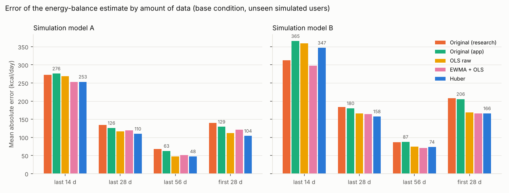
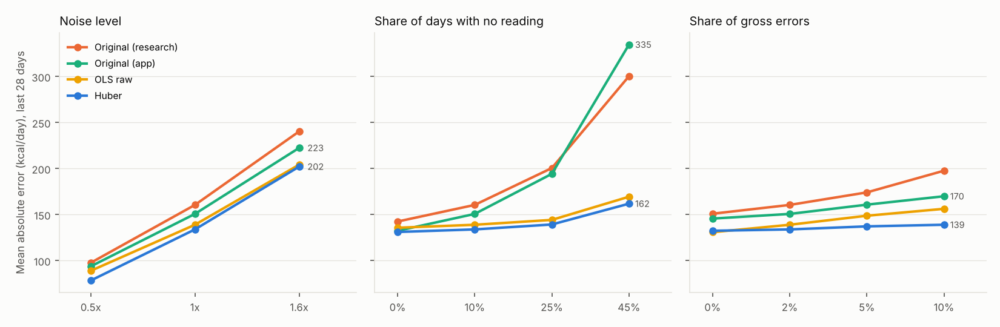
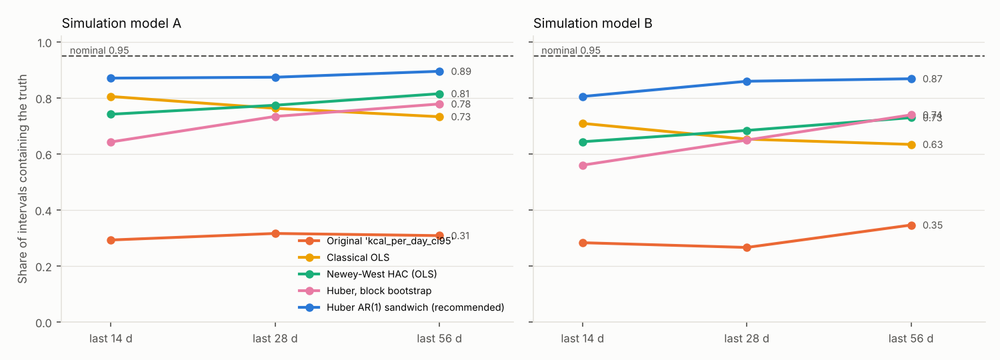
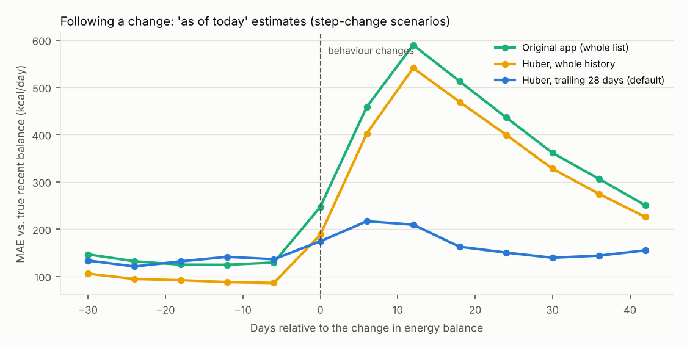
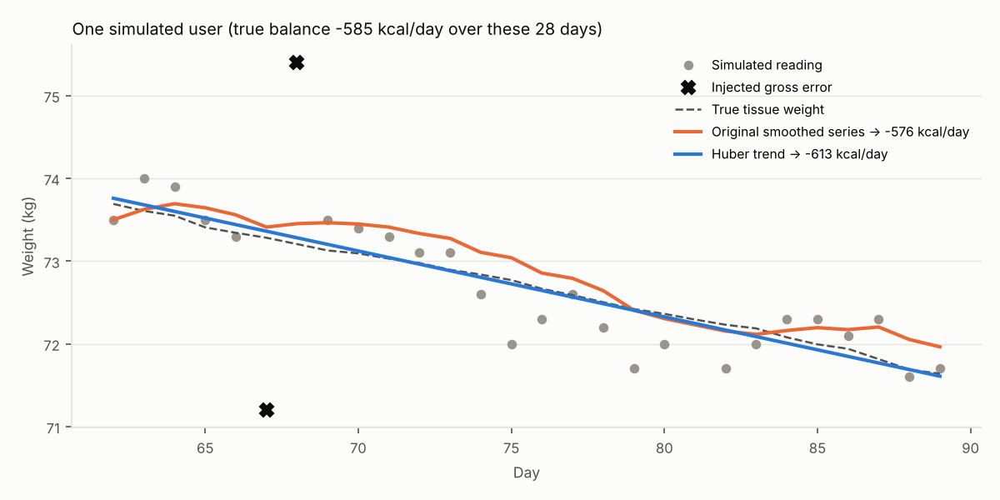

<!-- GENERATED by `python -m experiments.build_report` from docs/templates/ORIGINAL_VS_IMPROVED.template.md. Edit the template, not this file. -->
# Original vs Improved Pipeline

A reproducible, like-for-like comparison of the internship estimator and the corrected one. **Simulated data only.** Full detail: `EXPERIMENT_RESULTS.md`.

## How the comparison is kept fair

- The original code is frozen in `src/legacy/` and is byte-identical to the delivered ZIP (`tests/test_legacy_frozen.py` checks the SHA-256).
- Both pipelines receive exactly the same readings for every simulated user and window (`tests/test_experiments.py::test_all_methods_receive_identical_readings_and_truth`).
- The original is given a bare list of readings, which is all the original app stored.
- Users are generated from evaluation seeds that played no part in designing the new method. The original has no tuned parameters here, so it cannot be disadvantaged by the split.
- The clean condition (no missed days, no gross errors), which favours the original, is reported next to the others.

## Newly generated results (this project, evaluation seeds)

Mean absolute error of the energy-balance equivalent, kcal/day:

| evaluation data (simulated, unseen users) | n users | Original app MAE | Original research-module MAE | Corrected (Huber) MAE |
|---|---|---|---|---|
| base, last 28 d | 1800 | 153 | 159 | 134 |
| base, last 56 d | 1800 | 75 | 77 | 61 |
| base, last 14 d | 1785 | 320 | 292 | 300 |
| clean, last 28 d | 1200 | 127 | 131 | 130 |
| clean, last 56 d | 1200 | 57 | 59 | 60 |
| missing 45%, last 28 d | 474 | 335 | 300 | 162 |
| gross errors 10%, last 28 d | 480 | 170 | 198 | 139 |
| high noise, last 28 d | 480 | 223 | 240 | 202 |

Paired differences with 95% bootstrap intervals (negative = corrected method closer to the truth):

| data | Huber compared with | n users | mean change in abs. error (kcal/day) | Wilcoxon p | share of users where Huber is closer |
|---|---|---|---|---|---|
| base, last 28 d | Original (research) | 1800 | -25.3 (-31.9 to -19.2) | <0.001 | 57% |
| base, last 28 d | Original (app) | 1800 | -19.3 (-22.8 to -15.9) | <0.001 | 60% |
| base, last 28 d | EWMA + OLS | 1800 | -8.1 (-12.6 to -3.4) | 0.004 | 53% |
| base, last 28 d | OLS raw | 1800 | -7.5 (-9.5 to -5.5) | <0.001 | 54% |
| base, last 56 d | Original (research) | 1800 | -16.8 (-19.4 to -14.1) | <0.001 | 61% |
| base, last 56 d | Original (app) | 1800 | -14.5 (-16.2 to -12.8) | <0.001 | 63% |
| base, last 56 d | EWMA + OLS | 1800 | -0.3 (-2.0 to +1.4) | 0.731 | 51% |
| base, last 56 d | OLS raw | 1800 | -0.8 (-1.6 to -0.1) | 0.043 | 51% |
| base, last 14 d | Original (research) | 1785 | +7.7 (-4.7 to +20.1) | 0.004 | 47% |
| base, last 14 d | Original (app) | 1785 | -20.5 (-29.2 to -12.4) | 0.005 | 52% |
| base, last 14 d | EWMA + OLS | 1785 | +24.8 (+13.9 to +35.4) | <0.001 | 45% |
| base, last 14 d | OLS raw | 1785 | -13.9 (-18.6 to -9.2) | <0.001 | 48% |
| clean, last 28 d | Original (research) | 1200 | -1.0 (-6.4 to +4.6) | 0.537 | 51% |
| clean, last 28 d | Original (app) | 1200 | +4.0 (+1.7 to +6.2) | 0.013 | 48% |
| clean, last 28 d | EWMA + OLS | 1200 | +2.0 (-2.5 to +6.6) | 0.502 | 50% |
| clean, last 28 d | OLS raw | 1200 | +0.8 (-0.5 to +2.1) | 0.313 | 48% |
| clean, last 56 d | Original (research) | 1200 | +1.1 (-1.1 to +3.2) | 0.561 | 49% |
| clean, last 56 d | Original (app) | 1200 | +2.7 (+1.7 to +3.6) | <0.001 | 46% |
| clean, last 56 d | EWMA + OLS | 1200 | +2.1 (+0.3 to +3.8) | 0.144 | 50% |
| clean, last 56 d | OLS raw | 1200 | +0.9 (+0.4 to +1.4) | 0.008 | 48% |
| missing 45%, last 28 d | Original (research) | 474 | -138.5 (-159.4 to -116.4) | <0.001 | 73% |
| missing 45%, last 28 d | Original (app) | 474 | -172.8 (-194.2 to -152.5) | <0.001 | 82% |
| missing 45%, last 28 d | EWMA + OLS | 474 | +3.0 (-7.7 to +13.9) | 0.308 | 47% |
| missing 45%, last 28 d | OLS raw | 474 | -7.6 (-13.1 to -2.1) | 0.038 | 47% |
| gross errors 10%, last 28 d | Original (research) | 480 | -58.7 (-72.9 to -45.3) | <0.001 | 61% |
| gross errors 10%, last 28 d | Original (app) | 480 | -31.0 (-39.4 to -23.6) | <0.001 | 64% |
| gross errors 10%, last 28 d | EWMA + OLS | 480 | -35.0 (-46.7 to -23.9) | <0.001 | 56% |
| gross errors 10%, last 28 d | OLS raw | 480 | -17.3 (-23.0 to -11.5) | <0.001 | 57% |
| high noise, last 28 d | Original (research) | 480 | -38.2 (-53.7 to -22.0) | <0.001 | 59% |
| high noise, last 28 d | Original (app) | 480 | -20.3 (-29.1 to -12.2) | <0.001 | 60% |
| high noise, last 28 d | EWMA + OLS | 480 | -10.0 (-22.2 to +2.5) | 0.117 | 54% |
| high noise, last 28 d | OLS raw | 480 | -2.1 (-6.8 to +2.7) | 0.481 | 50% |

Other before/after measures:

| Measure | Original | Corrected |
|---|---|---|
| "95%" interval containing the truth (base condition, all windows) | 30% | 86% |
| Deficit/surplus outputs pointing the wrong way, 28 days of data | 15% (always outputs a signed number) | 4.1% (labels 44% of users, says "not yet clear" for the rest) |
| Error in the 4 weeks after a change of behaviour, kcal/day | 448 | 188 |
| Readings flagged on error-free data | 10.7% flagged and overwritten | under 4% marked unusual, none overwritten |
| Noise-free -550 kcal/day line, 14 days | -448 (research module) | -550 |
| Same line with 40% of days missing | -906 (app) | -550 |











The worked example shows what each pipeline fits for one simulated user. A single case says nothing about average accuracy; in this one the original happens to land closer to the truth.

## Where each pipeline succeeds and fails

| Situation | Original | Corrected |
|---|---|---|
| Complete daily logs, no gross errors, 4-8 weeks | Accurate; as good as the corrected method (127 vs 130 at 28 days) | Accurate |
| Two weeks of data | Research module has the lower average error (292 vs 300) because it shrinks estimates; it still prints a confident number | No label, reliability "low"; honest that the data are insufficient |
| Missed days | Fails: error grows with the share of missed days (335 at 45%) | Unaffected in bias; error 162 |
| Gross errors | Degrades (170 at 10%) | Nearly flat (139) |
| Stating uncertainty | Interval right 30% of the time | 86%; still short of 95% |
| After a change of behaviour | Whole-history average, slow to move | Trailing window follows the change; worse than a longer window when nothing changes |
| True conversion factor differs from 7,700 | Wrong | Equally wrong; stated as an assumption |
| Start or end of a diet (water shifts) | Biased | Equally biased; stated as a limitation |

## Historical saved results (not regenerated as new findings)

`results/model_evaluation.json`, written by the internship version on 2026-08-25, concerns the secondary forecasting feature on the internship synthetic cohort:

| Method | Saved MAE (kg) | Reproduced here from the saved model |
|---|---|---|
| LSTM | 0.537 | 0.537 |
| Persistence | 0.468 | 0.468 |
| Linear extrapolation | 0.401 | 0.401 |

The internship README's energy-balance accuracy table ("median 8 kcal/day") is also historical, and its reference was circular (`CORRECTIONS_REPORT.md`, issue 1). New forecasting results are in `EXPERIMENT_RESULTS.md` section 11 and `results/forecast_reevaluation.json`.

## Reproduce

```bash
python -m experiments.audit_original
python -m experiments.run_experiments --stage all
python -m experiments.forecast_experiment
python -m experiments.forecast_reevaluation      # needs TensorFlow
python -m experiments.summarize
python -m experiments.build_report
```
