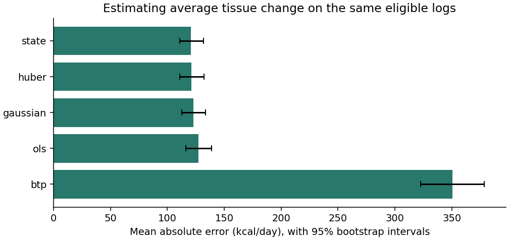
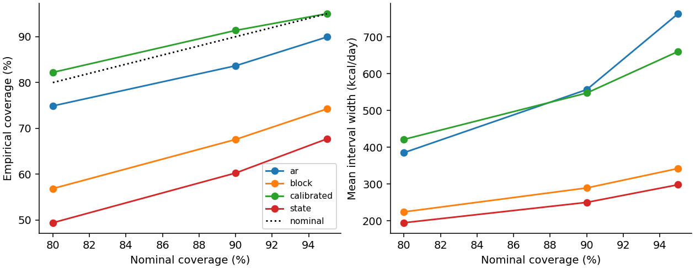
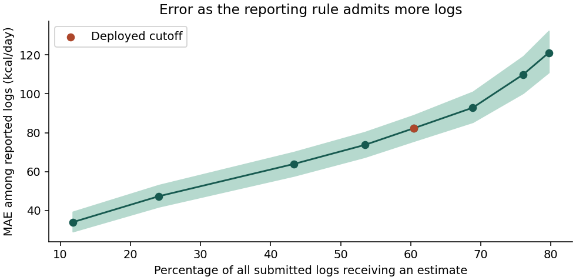

# Simply-Fit | Final M.Tech research report

**How much can a dated weight log tell us about energy balance?**  
Akshit Tyagi · Agricultural and Food Engineering · IIT Kharagpur  
Synthetic methods study · November 2026

## 1. Research finding

A date-aware Huber slope remains a defensible point estimator. On the same 765 eligible synthetic logs, a robust state-space alternative changed mean absolute error by −0.16 kcal/day relative to Huber, with a paired 95% bootstrap interval of −2.81 to +2.58. The main advance is measuring when an answer deserves to be displayed. A selective reporting policy issued estimates for 580 of 960 simulated users. At that operating point average error was 82.3 kcal/day, and the nominal 95% interval covered the target on 95.2% of reported logs.

The default 28-day window is harder than the pooled result suggests. Its interval covered on 57 of 65 reported logs (87.7%). A separate long-water stress test reduced coverage to 79.4%. A user with a prolonged water shift can receive a confident-looking, incorrect estimate. No real longitudinal data were available to measure how often this happens outside the simulations.

| Research contribution | BTP old | Submitted MTP | Final MTP |
|---|---|---|---|
| Measurement clock | Entry index | Actual dates and trailing windows | Same clock and aligned truth between observed endpoints |
| Point estimates | EWMA and Isolation Forest; separate app and research slopes | Huber, OLS and other regression comparisons | Robust and Gaussian local-trend filters evaluated against the incumbent |
| Simulated disturbances | Synthetic weight logs calibrated demographically | Ledger and adaptive two-compartment generators | Independent event-driven water pulses, persistent offsets, informative weighing and off-distribution persistence |
| Uncertainty | Research interval after smoothing | AR(1), HAC and block-bootstrap experiments | Three nominal levels, independent calibration, width and conditional coverage |
| Reporting | Displays a number | Minimum history and qualitative data-quality checks | Empirically evaluated abstention and reporting-specific calibration |
| Supporting evidence | Historical models and notebooks | Saved A/B experiments and application tests | Frozen originals, person-level outputs, paired effects, causal limitations example and deployment tests |

The original MTP already corrected the largest BTP error under irregular weighing. The final project does not claim that gain as a new contribution. The BTP comparison uses its original **displayed** estimate. Both original ZIP files, including the BTP research engine, are preserved in research/baselines.

## 2. Study design and ground truth

For first and last observed days a and b, the primary target is **T = 7700 × (M[b] − M[a]) / (b − a)**, where M is unobserved tissue-equivalent mass in kg. The secondary target is **E = mean(E[a], …, E[b−1])**, the simulator's realized energy balance. T answers how the mass trend would translate under the app's fixed conversion. E allows that conversion to be wrong. A recent change can make both window averages poor descriptions of today's balance.

Each independent person has one log in the main comparison. All estimators receive the same observed masses. Only the historical BTP method ignores their dates, as its interface originally did. All primary comparisons require ten readings spanning at least fourteen calendar days. Logs failing that rule are counted in reporting rates. Restricting the error table to common eligible logs prevents one method from benefiting from an easier sample.

| Stage | Seed family | Attempted | Eligible | Use |
|---|---:|---:|---:|---|
| Development | 421031 | 480 | 379 | Choose point method and score cutoff |
| Validation | 636017 | 640 | 532 | Calibrate interval multipliers, including 402 accepted logs |
| Final | 853049 | 960 | 765 | Evaluate the frozen policy |
| Paired sensitivity | 974053 | 100 independent people per setting | Varies | Reuse person-level innovations when changing one parameter |
| Longer water persistence | 1090017 | 480 | 390 | Test the frozen policy outside its calibration range |

A seed pair (stage seed, person ID) regenerates an individual's parameters, mass trajectory and observed days. Main cohorts draw new people and parameter values from the same parameter laws. The shifted cohort explicitly changes one parameter law. Calibration quantiles and point selection are serialized separately. The final and diagnostic commands only read those choices. Historical A/B results use different targets, sampling and observation conditions, so absolute errors from their tables cannot be compared directly with this third environment.

## 3. Independent simulator

The new generator imports no estimation code. It generates daily demand D from a steady baseline, a step or an 18-day ramp. A lagged response follows A[t] = A[t−1] + (D[t−1] − A[t−1])/τ. Realized balance is E[t] = D[t] − α A[t]. Tissue mass evolves as M[t+1] = M[t] + E[t]/ρ. Neither a straight observed line nor a Gaussian local-linear filter generates the observations.

The scale reads rounded tissue mass plus an independent water process, a temporary offset, heavy-tailed noise and occasional gross errors. Signed water pulses arrive on 16% of days and decay exponentially. Thirty pre-observation days reduce initialization effects. Missingness is applied after the unobserved daily state is generated.

| Quantity | Values used | Interpretation |
|---|---|---|
| Initial mass; demand | 58–105 kg; baseline and change each uniform from −550 to +550 kcal/day | Design envelope, including near-maintenance cases |
| Adaptation | α from 0 to 0.35; τ from 10 to 35 days | Individual response to sustained demand; a stress model |
| True density ρ | Uniform 5,200–9,200 kcal/kg per person | Mixed-composition sensitivity range |
| Water and offsets | Signed pulses 0.18–1.25 kg, decay 2–6 days; temporary offset ±0.35–1.15 kg for 3–13 days | Correlated deviations and unrelated abrupt mass changes |
| Scale conditions | 0.1-kg rounding; Student-t errors with 5 degrees of freedom scaled to SD 0.12, 0.28 or 0.50 kg | Includes time-of-day and nonstandard weighing noise |
| Outliers | 0%, 2.5% or 8%; signed errors 1.2–3 kg | Deliberate stress levels |
| Observation schedule | 14, 28, 42, 56 or 84 days; every 1, 2 or 3 days, with daily sampling twice as likely | Characteristics drawn independently in the main cohort |
| Missed scheduled observations | 14% random, or probability 0.05 + 0.55 × logistic(3 × (water − 0.35)) | Informative mechanism can hide a positive water deviation |
| Shift experiment | Water pulse decay increased to 8–14 days | Checks transport of the frozen calibration |

Hall shows why tissue composition changes the energy content of weight loss and why water change can carry no energy. Dynamic energy-balance models also motivate delayed adaptation. These sources motivate mechanisms. The exact distributions, dropout slope, ranges and mixture weights above are researcher-selected stress assumptions. [Hall 2008](https://pubmed.ncbi.nlm.nih.gov/17848938/) · [Hall et al. 2011](https://pmc.ncbi.nlm.nih.gov/articles/PMC3880593/)

A standardized single-person study found a one-day relative-change SD of 0.53%. A study of active men reported a group coefficient of variation of 0.66%. In the new held-out panel, the median absolute adjacent-day change was 0.30 kg and its 90th percentile was 1.30 kg. The simulation includes intentionally bad weighing conditions. These comparisons give scale context only. [Day-to-day variability in euvolemic body mass](https://pubmed.ncbi.nlm.nih.gov/37955103/) · [Daily body mass variability in active men](https://pubmed.ncbi.nlm.nih.gov/15673099/)

## 4. Estimation and calibration mathematics

**Baselines.** BTP replaces Isolation Forest flags with an EWMA value and fits OLS against reading index. Dated OLS minimizes the sum of squared residuals. Huber iteratively solves a weighted straight-line fit, with weight min(1, 1.345 s / |residual|) and a robust scale s. Both estimate an average trend. With changing balance, the regression slope need not equal the endpoint secant even in the absence of noise.

**State-space model.** The state is (m, v, m₀), current latent level, velocity and initial latent level. After Δ calendar days the predicted mean is (m + Δv, v, m₀). The upper 2 × 2 process covariance is q² times [[Δ³/3, Δ²/2], [Δ²/2, Δ]], with q = 0.004 kg/day^(3/2). The remaining entries are zero. The observation is y = m + ε. The model uses a log-specific observation SD equal to the larger of 0.16 kg and the Huber residual scale. The initial level SD is 10 kg and velocity SD is 0.12 kg/day. Initial and current levels are initially identical. Centering on the first reading sets the coordinate origin for this diffuse-level initialization.

At each reading, predict level and covariance P, form innovation e = y − predicted level and S = P₁₁ + R, then update using K = P[:,1]/(P₁₁ + R) in one-based indexing. For the robust version multiply R by max(1, |e|/(2.5 √S))² before computing K. An isolated large innovation has reduced influence. The Gaussian ablation leaves R untouched. For c = (1,0,−1)/(b−a), the reported state estimate is 7700 c′x, with model-based SE 7700 √(c′Pc). Retaining m₀ and its covariance with the current level avoids treating the two endpoints as independent. The reported statistic describes the average interval change, even though the filter admits an evolving velocity.

**Point selection.** Development MAEs for Huber, OLS, robust state and Gaussian state were 130.8, 140.6, 131.5 and 135.5 kcal/day. The protocol prefers Huber if its loss is within one paired standard error of the lowest. Huber had the lowest development loss outright. The state filter still contributes an estimator-disagreement diagnostic.

**Uncertainty competitors.** The inherited AR(1) sandwich uses estimated positive residual correlation across actual day gaps and an effective-degrees-of-freedom t multiplier. The moving-block residual bootstrap refits Huber on 199 draws, using consecutive reading-order blocks of length ceil(n^(1/3))+1. This preserves short runs approximately and can join readings separated by long calendar gaps. The robust filter uses Gaussian marginal quantiles and its model SE; its robust updates and estimated noise make that approximation imperfect.

**Selective reporting.** Define L as elapsed days, g as the largest gap, s as the floored residual scale, C as the original AR 95% half-width, and H, O, K as Huber, OLS and robust state estimates in kcal/day. Define U = 7700 s √g / √Σ(tᵢ − mean(t))². The scale used for ranking is

**r = √[(4500/L)² + U²] + 0.2 |H − O| + 0.2 |H − K| + 0.25 min(C, 2000).**

This empirical score penalizes short windows, sparse or uneven coverage, scatter, unstable fit and broad intervals. It has no individual probability interpretation. Its coefficients are design assumptions. The development 75th percentile sets the cutoff at 384.8. Choosing to target 75% of eligible histories is an explicit operational preference. The risk curve shows the consequences of choosing a different reporting rate. The deployed app withholds results beyond 84 observed calendar days unless a supported trailing window is selected.

**Calibration.** For each validation user compute uᵢ = |Tᵢ − Hᵢ|/rᵢ. For nominal coverage p use the ceil((n+1)p)-th ordered u. The interval is H ± r × u₍ₖ₎. Calibrate once on all eligible logs for method comparison and separately on accepted logs for the app. The accepted-log multipliers are 0.748, 0.933 and 1.112 at 80%, 90% and 95%. This split-conformal construction targets marginal coverage for a new exchangeable synthetic user's latent window quantity in the corresponding population. It gives no guarantee for a particular duration, for today's energy balance, for physiological energy balance, or under distribution shift.

A future scale-reading prediction interval has a different target and units (kg). It includes future water and measurement variation. The app retains the previous recent-level forecast and its separate backtested prediction band. The slope band on the trend graph illustrates compatible slopes anchored at the fitted midpoint; it is not a simultaneous confidence band for the entire trajectory.

## 5. Independent final results

| Method, same 765 logs | MAE | 95% CI for MAE | RMSE | Bias |
|---|---:|---:|---:|---:|
| Original BTP app | 350.4 | 322.5–378.6 | 534.2 | +21.0 |
| Dated OLS | 127.2 | 116.5–138.7 | 204.7 | −3.3 |
| Submitted MTP Huber | 121.1 | 111.0–132.3 | 194.8 | −0.6 |
| Gaussian state-space | 122.7 | 112.6–133.8 | 194.8 | −3.6 |
| Robust state-space | 120.9 | 110.8–131.9 | 191.7 | −1.0 |

All errors are kcal/day against the average tissue trend equivalent. Bias means estimate minus target. Error CIs use 2,000 person-level bootstrap samples. Paired differences reuse each person's two predictions. Huber improved over OLS by 6.1 kcal/day (paired 95% CI 2.5–9.8). The apparent state-space advantage is too small to resolve. Against realized physiological balance, Huber MAE rose to 130.7. A small pooled signed bias can hide large errors in opposite directions.

| Interval, all eligible | Coverage at 80% | At 90% | At 95% | Mean full width at 95% |
|---|---:|---:|---:|---:|
| Huber AR(1) | 74.9% | 83.7% | 89.9% | 762.8 kcal/day |
| Moving block | 56.9% | 67.6% | 74.2% | 342.4 kcal/day |
| Robust state covariance | 49.4% | 60.3% | 67.7% | 298.3 kcal/day |
| Simulation-calibrated | 82.2% | 91.4% | 95.0% | 660.1 kcal/day |

Among **reported** logs, AR achieved 88.8% coverage at mean full width 434.0. The accepted-log calibration achieved 95.2% (Wilson 95% CI 93.1–96.6%) at width 432.8. It covered **realized physiological balance** only 89.7% of the time. The default 28-day reported subset had a wider mean interval of 664.0 kcal/day and 87.7% coverage (Wilson CI 77.5–93.6%). No 14-day final history passed the selective gate. Pooling durations masks this heterogeneity.

## 6. Reporting rate, ablations and failure modes

| Operating point | Estimates / 960 | Among all logs | MAE of reported estimates |
|---|---:|---:|---:|
| Development median cutoff | 416 | 43.3% | 63.9 |
| Deployed cutoff | 580 | 60.4% | 82.3 |
| Development 95th-percentile cutoff | 730 | 76.0% | 109.9 |
| All eligible | 765 | 79.7% | 121.1 |

The original minimum-history rule excluded 195 users. The new gate withheld another 185. Issuing fewer estimates lowers the average error of those displayed. It does not improve a particular user's Huber point estimate. The 95% bootstrap interval for the reported-subset MAE was 75.7–89.0 kcal/day.

The one-factor study replays the same 100 simulated people under each setting. Its reference has 56 days, daily scheduled readings, random missingness, 0.28 kg scale noise, 2.5% gross errors, a step change, adaptation 0.18 and density 7,700 kcal/kg. Each target is recomputed for the actual endpoints. Changing duration can thus change the target as well as the quantity of information. Comparisons of differences use only people eligible under both settings.

| Huber perturbation | MAE | Paired MAE change from reference (95% CI) |
|---|---:|---:|
| Reference | 75.9 | 0 |
| 14 days | 383.7 | +309.4 (+242.6 to +378.1), 74 pairs |
| 84 days | 45.5 | −30.4 (−41.8 to −18.7) |
| Every third day | 83.2 | +7.3 (+0.2 to +14.2) |
| Scale noise 0.50 kg | 82.1 | +6.2 (+3.0 to +9.2) |
| Gross errors 8% | 78.8 | +2.9 (−0.5 to +6.2) |
| Informative missingness | 69.7 | −6.3 (−13.2 to −0.1) |

In this particular dropout model, positive water excursions are more likely to disappear. That can improve point error while changing the observed population. The dropout rates also differ; this comparison does not isolate selection bias at a matched observation count. In these runs changing adaptation alone had little visible effect on average trend error. All four estimators have MAE, RMSE, bias and paired uncertainty in ablations.csv. intervals.csv gives coverage, Wilson intervals and widths across the same conditions. Comparisons are descriptive and unadjusted for multiplicity.

**Persistent water is the principal identified failure.** Among 272 reported logs in the 480-person shifted cohort, MAE reached 142.5 kcal/day and the nominal 95% interval covered 79.4% (74.2–83.8%). The gate misses some slow water changes because a smooth water trend can resemble tissue change. Passing a quality check cannot resolve that ambiguity.

**Identifiability experiment.** Two simulated worlds produce identical readings, 76.00 to 74.36 kg over 41 elapsed days. In A all change is tissue (−0.04 kg/day at 7,700 kcal/kg), yielding −308 kcal/day. In B tissue falls 0.02 kg/day and water falls 0.02 kg/day, with tissue density 5,500, yielding −110 kcal/day. The app returns −308 for both. No weight-only estimator can distinguish these worlds. Even knowing exact net balance leaves infinitely many intake–expenditure pairs with the same difference.

**Density sensitivity.** Under a true density of 5,200 the fixed-conversion Huber method had MAE 77.0 against T and 158.1 against E in the paired sweep. In a separate descriptive calculation on the final cohort, applying assumed factors of 5,200, 7,700 and 9,200 to the same slopes gave physiological MAEs of 110.5, 130.7 and 176.0. A lower factor shrinks noisy predictions toward zero; it cannot establish an individual's density. These retrospective settings were never used to change the deployed conversion.

## 7. Application and verification

The tracker, report, rolling intervals and coach use the selected reporting policy. Withheld periods leave gaps in the rolling chart. The existing Huber core remains separately callable for reproduction. Invalid or insufficient logs return an explanatory status. A nonfinite date is rejected before span conversion. The coach uses the same selected window as the tracker. The local retrieval pipeline, optional Gemini connection, forecast fallback and optional LSTM artifacts are preserved.

Automated checks exercise the headless Streamlit workflow, no-key coach, forecast, model artifacts, dataset integrity, input parsing, state invariances, missing dates, withheld outputs and rolling-window causality. All 164 tests passed, including the optional LSTM test. The running Streamlit server returned HTTP 200 and a healthy status. Exact executed test output is saved in results/verification.txt. The incoming MTP suite also ran before integration (157 passed and one optional TensorFlow test skipped in the base environment). A replay of all 960 final logs and 480 shifted logs matched the deployed decisions, point estimates and bounds. The optional model was subsequently exercised in the final TensorFlow environment. Live Gemini generation was not exercised. No retraining or real-patient validation was performed.

Start with the top-level README for launch and reproduction. The files points.csv, paired.csv, intervals.csv, ablations.csv, selection_curve.csv, assumed_density.csv and identifiability.csv under research/results contain the numerical comparisons. The historical simulation tables under the original results tree belong to the submitted MTP. Reported uncertainty quantifies finite simulated samples and model assumptions. It does not quantify how representative the simulator is of people.
